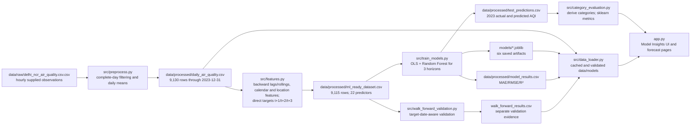
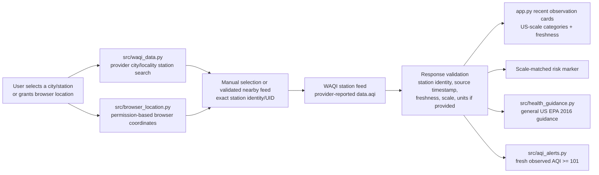
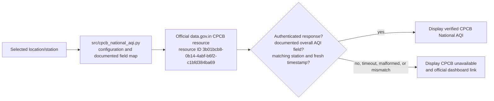

# SaansCheck — Project Structure and Architecture

## Main directory structure

```text
Saanscheck gravity/
|-- app.py
|-- README.md
|-- requirements.txt
|-- assets/
|   `-- SaansCheck Delhi Air Quality Emblem.png
|-- data/
|   |-- raw/
|   |   `-- delhi_ncr_air_quality.csv.csv
|   `-- processed/
|       |-- daily_air_quality.csv
|       |-- ml_ready_dataset.csv
|       |-- model_results.csv
|       |-- test_predictions.csv
|       |-- feature_importance.csv
|       |-- walk_forward_results.csv
|       |-- walk_forward_category_results.csv
|       `-- reports, validation artifacts, and provenance notes
|-- docs/
|   |-- SAANSCHECK_REPORT_FACTS.md
|   |-- SAANSCHECK_PROJECT_STRUCTURE.md
|   `-- report_evidence/
|-- models/
|   |-- linear_regression_day1.joblib
|   |-- linear_regression_day2.joblib
|   |-- linear_regression_day3.joblib
|   |-- random_forest_day1.joblib
|   |-- random_forest_day2.joblib
|   `-- random_forest_day3.joblib
|-- notebooks/
|-- src/
|   |-- aqi_alerts.py
|   |-- aqi_calculator.py
|   |-- aqi_risk_scale.py
|   |-- aqi_validation.py
|   |-- browser_location.py
|   |-- conformal_intervals.py
|   |-- cpcb_national_aqi.py
|   |-- dashboard_insights.py
|   |-- data_loader.py
|   |-- features.py
|   |-- forecast_features.py
|   |-- health_guidance.py
|   |-- live_data.py
|   |-- live_forecast.py
|   |-- preprocess.py
|   |-- theme.py
|   |-- train_models.py
|   |-- ui_components.py
|   |-- walk_forward_validation.py
|   |-- waqi_data.py
|   `-- xkdr_data.py
`-- tests/
    `-- unittest modules for AQI, data, UI, model, and provider behavior
```

The `.streamlit/` directory contains local Streamlit configuration/secrets. Do not copy secret values into reports, screenshots, logs, or shared source.

## Important Python files

- `app.py`: initializes Streamlit, selects Historical Intelligence or Recent Air Quality, renders the workspace navigation/pages, and composes UI, data, models, and source integrations.
- `src/data_loader.py`: schema-checks and caches daily/ML CSVs, model metrics, predictions, feature importance, and the six saved model objects.
- `src/preprocess.py`: converts hourly input into complete daily records, aggregating pollutant and supplied AQI values.
- `src/features.py`: creates per-location lag/rolling predictors, location indicators, and direct `t+1`, `t+2`, `t+3` targets.
- `src/train_models.py`: offline training/evaluation entry point for Linear Regression and Random Forest at three horizons.
- `src/category_evaluation.py`: derives per-class scores, fixed-order confusion matrices, and support counts from stored held-out regression predictions, using the existing preprocessing category thresholds.
- `src/forecast_features.py`: aligns the inference feature row to the training feature order and calls direct-horizon saved models.
- `src/dashboard_insights.py`: helpers for historical summaries, comparisons, calendar/seasonal analysis, and model views.
- `src/walk_forward_validation.py`: expanding, chronological evaluation where training cutoffs are applied to target dates.
- `src/waqi_data.py`: WAQI station search and feed requests; validates responses, station identity, source timestamps, and freshness.
- `src/browser_location.py`: browser-side geolocation component. Coordinates are used only for the validated lookup flow.
- `src/cpcb_national_aqi.py`: official OGD request and strict mapping/validation for a provider-reported overall CPCB AQI; unavailable/error states are returned instead of a substitute.
- `src/health_guidance.py`, `src/aqi_alerts.py`, `src/aqi_risk_scale.py`: scale-specific advice, observed-data alert lifecycle, and current category marker semantics.
- `src/theme.py`, `src/ui_components.py`: shared theme and reusable presentation components.
- `src/aqi_calculator.py`, `src/aqi_validation.py`: pollutant/AQI calculation and research validation utilities; they do not establish provenance for the historical CSV target.
- `src/live_forecast.py`: readiness/status for recent-source forecasting; the current UI withholds predictions when compatible matched station history is unavailable.
- `src/conformal_intervals.py`: interval utilities used by validation/forecast-support code.
- `src/live_data.py` and `src/xkdr_data.py` exist in the source tree; an active `app.py` route using them was not established in this audit.

## Streamlit page and navigation flow

```text
Application shell
|
|-- Historical Intelligence
|   |-- Overview
|   |-- AQI Forecast
|   |-- Location Intelligence
|   |-- Pollution Analytics
|   |-- Daily AQI Calendar
|   |-- Seasonal Risk
|   |-- Health Advisor
|   |-- Model Insights
|   `-- Learn About AQI
|
`-- Recent Air Quality
    |-- Recent Overview
    |-- Pollutant Trends
    |-- Location Data
    |-- Data Freshness
    `-- Forecast (status/availability; not a current future forecast without a validated model contract)
```

Appearance controls expose Dark and Light themes. The Recent Air Quality workspace also includes Automatic nearby and Manual city/station selection.

## Historical data and prediction flow



The historical `aqi` field is carried from the supplied data; preprocessing averages it by complete location-day. The model predicts this dataset-defined target. It is not established as CPCB National AQI.

## Recent WAQI observation flow



Pollutant AQI sub-indices are not presented as physical concentrations. Missing or stale station readings do not get replaced with historical or synthetic data. Automatic location lookup checks station coordinates and rejects an unverified/mismatched station.

## CPCB safe-failure flow



The current audited state follows the unavailable branch because the bounded authenticated resource request timed out and no verified overall-AQI response was obtained. No WAQI-to-CPCB conversion is performed.

## Libraries and their observed uses

| Library | Observed project use |
|---|---|
| Streamlit | Dashboard, state, caching, and app tests |
| pandas | CSV processing, grouping, features, validation |
| NumPy | Numerical operations and model/evaluation support |
| scikit-learn | Linear Regression, Random Forest, metrics |
| joblib | Saved model persistence/loading |
| Matplotlib and Seaborn | Historical/validation visualizations |
| requests | WAQI and data.gov.in HTTPS requests with bounded timeouts |
| Python standard library | Date/time, JSON, paths, math, typing, tests, and browser-component support |

## Evidence and interpretation notes

- Historical source and pollutant units remain unverified; do not label the historical AQI as official CPCB.
- WAQI reports the US EPA 2016 scale; it is not Indian National AQI.
- The saved origin-year 2023 holdout permits some training target dates to overlap 2023. Prefer the separate target-date-aware walk-forward results for temporal validation discussion.
- Historical forecast targets shown by the app are January 1–3, 2024; they are not current forecasts.
- See `docs/SAANSCHECK_REPORT_FACTS.md` and `docs/report_evidence/` for the detailed fact sheet and genuine UI captures.
